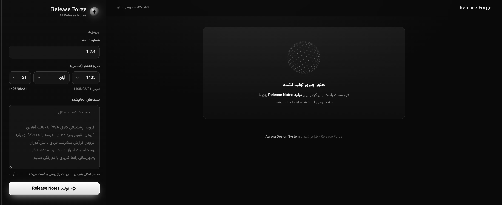
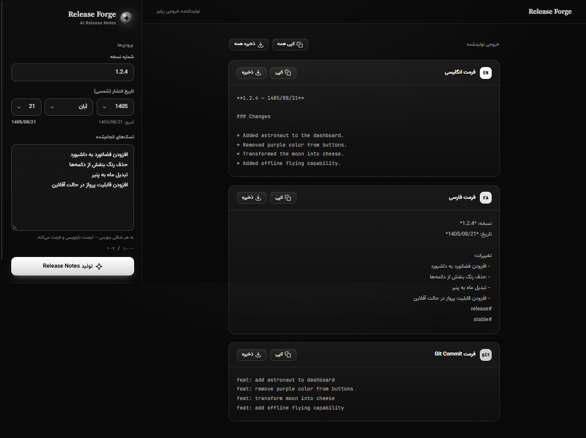
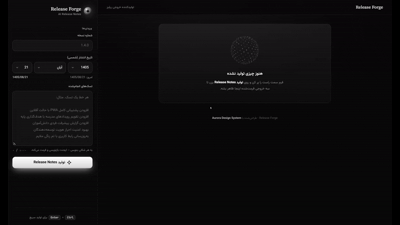

<div align="center">

# ⚡ Release Forge

**تولیدکنندهٔ هوشمند Release Notes — خروجی انگلیسی، فارسی و Git Commit در یک مرحله**

[](https://php.net)
[](LICENSE)
[](https://openai.com)

[](https://github.com/notmohammadxm/releaseforge/stargazers)
[](https://github.com/notmohammadxm/releaseforge/network/members)
[](https://github.com/notmohammadxm/releaseforge/issues)

[🚀 نصب سریع](#-نصب-سریع-quick-start) · [✨ ویژگیها](#-ویژگیها-features) · [📸 اسکرینشات](#-اسکرینشاتها--دمو) · [🛠 استک فنی](#-استک-فنی-tech-stack)

</div>

---

## 💡 ایدهی پروژه (Concept)

> **Release Forge** یک ابزار سبک PHP است که فهرست خام تسکهای انجامشده در یک نسخه را دریافت میکند و با استفاده از مدلهای زبانی، آن را به سه فرمت استاندارد و آمادهی انتشار تبدیل میکند:
>
> 1. **Changelog انگلیسی** (برای انتشار عمومی و بینالمللی)
> 2. **Changelog فارسی** (برای کاربران فارسیزبان، با تاریخ شمسی)
> 3. **خلاصهی Git Commit** (برای پیام کامیت تمیز و حرفهای)
>
> هدف، حذف کار دستیِ نوشتن release note و یکدست کردن خروجیهاست.

---

## 📸 اسکرینشاتها و دمو

<div align="center">

| حالت خالی (Empty State) | خروجی تولیدشده (Results) |
| :---: | :---: |
|  |  |

**دموی متحرک (GIF):**



</div>

---

## ✨ ویژگیها (Features)

| ویژگی | توضیح |
| :--- | :--- |
| 🌍 **سه خروجی در یک مرحله** | تولید همزمان چنجلاگ انگلیسی، فارسی و پیام Git Commit |
| 📅 **تاریخ شمسی (جلالی)** | انتخاب تاریخ شمسی با تبدیل خودکار از تقویم میلادی |
| 🎨 **رابط کاربری Aurora** | سطوح شیشهای مونوکروم، میکرواینتراکشنهای فنری و هیروی ابرنقطهای متحرک (Canvas) |
| ⚡ **AJAX + اسکلتون لودینگ** | تجربهی بدون رفرش با نمایش اسکلتون، توست و دانلود/کپی جداگانه برای هر کارت |
| 🧹 **پارسر مقاوم** | تحمل مارکداون/XML اضافی مدل و تمیزکاری خودکار خروجی |
| 📱 **طراحی ریسپانسیو** | فرم چسبان در دسکتاپ، چیدمان پشتهای در موبایل |
| 🔐 **امنیت کلید API** | خواندن کلید از طریق متغیر محیطی (`.env`) |

---

## 🚀 نصب سریع (Quick Start)

### پیشنیازها
- PHP نسخه **8.0** یا بالاتر
- افزونهی **cURL** فعال
- یک کلید API از سرویس هوش مصنوعی (مثلاً OpenAI یا GapGPT)

### ۱. دریافت کد
```bash
git clone https://github.com/notmohammadxm/releaseforge.git
cd releaseforge
```

### ۲. تنظیم متغیر محیطی
یک فایل `.env` در ریشهی پروژه بسازید (یا از متغیر محیطی سیستم استفاده کنید):
```env
AI_API_URL=https://api.gapgpt.app/v1/chat/completions
AI_API_KEY=your-api-key-here
AI_MODEL=gpt-4o
```

<details>
<summary><b>🔧 روشهای دیگر تنظیم متغیر محیطی (کلیک کنید)</b></summary>

**در Apache (فایل `.htaccess`):**
```apache
SetEnv AI_API_KEY your-api-key-here
SetEnv AI_MODEL gpt-4o
```

**در Nginx (فایل کانفیگ سایت):**
```nginx
fastcgi_param AI_API_KEY "your-api-key-here";
fastcgi_param AI_MODEL "gpt-4o";
```

**در Docker Compose:**
```yaml
environment:
  - AI_API_KEY=${AI_API_KEY}
  - AI_MODEL=gpt-4o
```
</details>

### ۳. اجرا
```bash
# با سرور داخلی PHP
php -S localhost:8000

# سپس در مرورگر باز کنید:
# http://localhost:8000
```

> [!IMPORTANT]
> هرگز کلید API را مستقیماً در کد قرار ندهید. همیشه از متغیر محیطی یا فایل `.env` استفاده کنید و فایل `.env` را در `.gitignore` قرار دهید.

---

## 🛠 استک فنی (Tech Stack)

| لایه (Layer) | تکنولوژی (Technology) |
| :--- | :--- |
| **Backend** | PHP 8+ (بدون فریمورک)، cURL |
| **Frontend** | JavaScript خالص (Vanilla JS)، HTML5 Canvas |
| **استایل** | CSS سفارشی بر پایهی Aurora Design System |
| **فونت** | Vazirmatn (فارسی)، Source Serif 4 (تیتر)، JetBrains Mono (کد) |
| **هوش مصنوعی** | GPT-4o (از طریق API سازگار با OpenAI) |
| **تاریخ** | تبدیل دستی میلادی به جلالی (بدون کتابخانهی خارجی) |

### ساختار فایل پروژه

```text
releaseforge/
├── index.php              # فایل اصلی (فرم + منطق + فراخوانی API)
├── README.md              # همین فایل
└── docs/
    └── images/
        ├── screenshot-empty.png
        ├── screenshot-results.png
        └── demo.gif
```

---

## 🗺 نقشه راه (Roadmap)

- [x] تولید سه فرمت خروجی (EN / FA / Git)
- [x] انتخاب تاریخ شمسی با تبدیل خودکار
- [x] رابط کاربری Aurora با انیمیشنهای Canvas
- [x] مدیریت خطا و نمایش وضعیت لودینگ
- [ ] پشتیبانی از چند مدل زبانی (Dropdown انتخاب مدل)
- [ ] خروجی بهصورت فایل ZIP
- [ ] ذخیرهی تاریخچهی تولید در دیتابیس (SQLite)
- [ ] نسخهی Docker-ready

---

## 🤝 مشارکت (Contributing)

از مشارکت شما استقبال میکنیم! لطفاً مراحل زیر را دنبال کنید:

1. **Fork** مخزن را بزنید
2. یک **branch** جدید بسازید: `git checkout -b feature/your-feature-name`
3. تغییرات خود را **commit** کنید: `git commit -m "feat: add your feature"`
4. **Push** کنید: `git push origin feature/your-feature-name`
5. یک **Pull Request** باز کنید

> [!NOTE]
> لطفاً قبل از ارسال PR، مطمئن شوید که کد شما با استانداردهای PHP 8+ سازگار است و هیچ کلید API یا اطلاعات حساسی در آن وجود ندارد.

---

## 📄 مجوز (License)

این پروژه تحت مجوز **MIT** منتشر شده است.

---

<div align="center">

ساختهشده با ❤️ در ایران

[⬆ بازگشت به بالا](#-release-forge)

</div>
